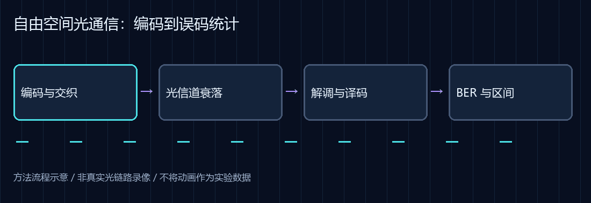
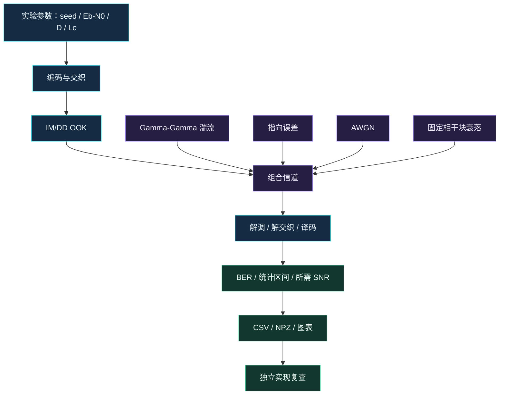
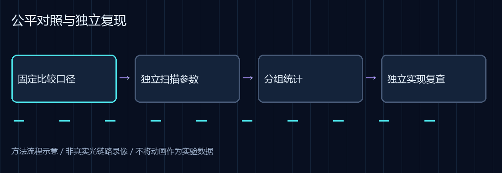

# 自由空间光通信编码与交织仿真

**Python · NumPy · IM/DD OOK · Gamma–Gamma · RS / LDPC · Monte Carlo · 统计区间**

[个人技术作品集](https://github.com/KristenYue) · [实验地图](docs/EXPERIMENT_MAP.md) · [主实验](primary_experiments) · [独立复现](replication)

面向自由空间光通信链路，构建从信道建模、编解码、交织到误码统计的 Python 仿真系统，研究：

**在相近编码冗余和相同物理信道条件下，RS 与 LDPC 如何取舍，交织深度怎样影响可靠性及缓存开销。**

本仓库公开硕士毕业设计相关实验代码、运行入口和工程说明，不包含论文。

---

## 本项目在技术作品集中的作用

| 能力 | 项目证据 |
|---|---|
| **通信系统理解** | 光强调制、噪声、湍流、指向误差、块衰落与编码 |
| **算法原型开发** | NumPy 信道与编解码实现、参数扫描、结果分析 |
| **公平实验设计** | 近似码率、统一信息比特 Eb/N0、匹配物理信道 |
| **统计可信度** | 分组感知区间、零误码上界、相关样本处理 |
| **可复现工程** | 固定种子、条件子流、扫描恢复与独立实现复查 |

AI 应用与设备软件主线见 [工业 Agent](https://github.com/KristenYue/telecom-network-incident-agent) 和 [C++ 设备运行时](https://github.com/KristenYue/edge-device-verification-lab)。本项目补充通信背景与数值实验纵深。

---

## 实验交付一览

| 项目 | 已交付内容 | 核查入口 |
|---|---|---|
| **主实验链** | **14 个 Python 实验脚本**，覆盖组件、编码、交织和最终对照 | [primary_experiments](primary_experiments) |
| **独立复现** | **12 个 Python 模块**，使用分离的实现路径复查关键步骤 | [replication](replication) |
| **工程复盘** | **7 个 Bad Case**，记录建模、对照和统计问题 | [BAD_CASES.md](docs/BAD_CASES.md) |
| **RS 编码配置** | RS(255,223)，码率约 **0.8745** | [编码验证](primary_experiments/03_rs_awgn_validation.py) |
| **LDPC 编码配置** | LDPC(512,449)，码率约 **0.8770** | [编码验证](primary_experiments/06_ldpc_awgn_validation.py) |
| **实验参数解耦** | 独立设置交织深度 `D` 与物理相干长度 `Lc` | [固定相干实验](primary_experiments/04c_rs_fso_fixed_coherence_interleaving.py) |

上述数字描述实验配置与代码交付规模。BER、编码增益、所需 SNR 等结论应依据对应扫描输出，不用脚本数量替代通信性能结果。

---

## 场景一：从编码到误码统计的链路仿真



> 方法流程示意动画，非真实光链路录像；动画不作为实验数据。

### 研究问题

自由空间光链路不仅受到加性噪声影响，也会受到湍流、指向误差和持续相关衰落影响。编码与交织能否改善误码表现，需要放在明确的信道假设下比较。

### 完整链路

```text
信息比特
  → RS / LDPC 编码
  → 交织
  → OOK 调制
  → Gamma–Gamma 湍流 + 指向误差 + AWGN
  → 解调
  → 解交织
  → 译码
  → BER、区间与开销统计
```

### 模块架构



### 组件先验证，再组合

| 层次 | 验证内容 | 目的 |
|---|---|---|
| 信道组件 | AWGN 参考、湍流采样与矩、指向误差 | 避免组件偏差污染最终对照 |
| 编解码 | RS 行为、LDPC 校验与无噪声往返 | 先排除编解码实现错误 |
| 组合链路 | 固定相干衰落下的编码与交织 | 分析系统级误码行为 |
| 结果统计 | 误码计数、区间和目标工作点 | 同时报告估计值与不确定性 |

[信道验证](primary_experiments/01_channel_model_validation.py) · [RS 验证](primary_experiments/03_rs_awgn_validation.py) · [LDPC 验证](primary_experiments/06_ldpc_awgn_validation.py)

---

## 场景二：公平对照、参数扫描与独立复现



> 动画展示实验组织方法，实际结论需读取脚本生成的结果。

### 设计一：统一能量口径与冗余开销

比较 RS 与 LDPC 时采用近似码率：

| 方案 | 配置 | 码率 |
|---|---|---:|
| RS | RS(255,223) | 约 0.8745 |
| LDPC | LDPC(512,449) | 约 0.8770 |

将编码前后的能量统一到**信息比特 Eb/N0**，同时保留未编码链路作为基线。

这使比较聚焦于编码方案与译码行为，减少不同冗余和能量定义引入的混淆。

### 设计二：交织深度与物理信道分离

- `D`：交织深度，属于软件与缓存设计参数。
- `Lc`：物理信道相干长度，表达衰落持续相关性。

固定 `Lc` 后扫描 `D`，观察误码表现与交织开销。避免增加交织深度时同时改变物理信道，从而产生不公平收益。

[固定相干实验](primary_experiments/04c_rs_fso_fixed_coherence_interleaving.py) · [深度取舍分析](primary_experiments/05_rs_coherence_depth_analysis.py)

### 设计三：相关样本采用分组统计

共享衰落实现的帧不应直接视为完全独立样本。

实验对相关衰落场景采用分组感知的区间估计；有限样本未观察到误码时，报告统计上界，不将其解释为 BER 等于零。

[分组感知实验](primary_experiments/07b_ldpc_fso_group_aware_refinement.py)

### 设计四：独立实现检查关键假设

主实验与复现路径分开：

```text
primary_experiments/
  → 主实验、扫描与最终对照

replication/
  → 分离的信道与编解码实现
  → 关键步骤复查
```

独立复现用于检查结果是否依赖单一路径，而不是重新绘制同一份输出。

[独立复现目录](replication) · [工程决策](docs/ENGINEERING_LOG.md)

---

## 实验地图与阅读顺序

| 阶段 | 入口 | 完成的任务 |
|---|---|---|
| 01 | `01_channel_model_validation.py` | 信道组件检查 |
| 02 | `02_uncoded_fso_ber.py` | 未编码链路基线 |
| 03 | `03_rs_awgn_validation.py` | RS 编解码与 AWGN 验证 |
| 04 | `04c_*` / `04d_*` | 固定相干长度下的交织实验 |
| 05 | `05_rs_coherence_depth_analysis.py` | 交织深度与工作点分析 |
| 06 | `06_ldpc_awgn_validation.py` | LDPC 构造与验证 |
| 07 | `07b_ldpc_fso_group_aware_refinement.py` | 匹配信道与分组统计 |
| 08 | `08_rs_ldpc_final_comparison.py` | RS / LDPC 最终对照 |
| 09 | `09_uncoded_fixed_coherence_coding_gain.py` | 匹配未编码基线与编码增益 |
| 10 | `10_turbulence_sensitivity.py` | 湍流敏感性分析 |

[完整实验地图](docs/EXPERIMENT_MAP.md)

---

## 可复现工程设计

| 工程问题 | 实现方法 |
|---|---|
| 随机结果难以复查 | 固定主种子与条件子流 |
| 长扫描中断 | 保存已完成条件，支持恢复与跳过 |
| 结果与分析耦合 | 生成数据与后续分析分离 |
| 单一库实现可能带来偏差 | 分离主实验与独立复现路径 |
| 仅报告点估计容易误读 | 同时输出统计区间与零误码上界 |
| 参数变化导致比较口径漂移 | 固定能量、码率及物理信道条件 |

---

## 运行方法

### 安装环境

```bash
python -m venv .venv

# Windows:
# .venv\Scripts\activate

# Linux / macOS:
# source .venv/bin/activate

python -m pip install -r requirements.txt
```

### 从组件验证开始

```bash
cd primary_experiments

python 01_channel_model_validation.py
python 03_rs_awgn_validation.py
```

先确认组件行为，再启动计算量较大的交织扫描与最终对照。其他实验参数与依赖关系见 [实验地图](docs/EXPERIMENT_MAP.md)。

### 独立复现路径

从仓库根目录执行：

```bash
cd replication

python fso_lib.py
python calc_baseline.py Moderate
```

CSV、NPZ 和图表由脚本在本地生成，读取与输出位置以各脚本说明为准。

---

## 工程复盘与关键检查点

- 不同编码比较时，检查码率与 Eb/N0 定义是否一致。
- 扫描交织深度时，检查是否保持相同物理相干条件。
- 多帧共享衰落实现时，检查统计独立性假设。
- 零误码场景报告上界，避免有限样本被误读。
- 先验证组件，再解释系统级编码收益。
- 保存随机条件、配置和中间结果，支持重新构建结论。

[7 个工程 Bad Case](docs/BAD_CASES.md) · [工程日志](docs/ENGINEERING_LOG.md)

---

## 源码与证据入口

| 内容 | 入口 |
|---|---|
| 主实验源码 | [primary_experiments](primary_experiments) |
| 独立复现 | [replication](replication) |
| 实验顺序与依赖 | [EXPERIMENT_MAP.md](docs/EXPERIMENT_MAP.md) |
| 实验设计与决策 | [ENGINEERING_LOG.md](docs/ENGINEERING_LOG.md) |
| 失败案例 | [BAD_CASES.md](docs/BAD_CASES.md) |

<details>
<summary>公开范围与实验口径</summary>

本仓库提供仿真代码与方法说明，不包含论文、完整生成数据和真实光学链路测量。

正式 Monte Carlo 扫描计算量较大，快速运行入口主要检查组件。

信道模型具有明确假设；固定种子、统计区间与独立实现提高可复查性，不替代硬件实验或第三方验证。

通信性能结论应对应实际输出、样本规模与统计区间，不凭代码结构推断编码增益。

</details>

---

[MIT License](LICENSE)
