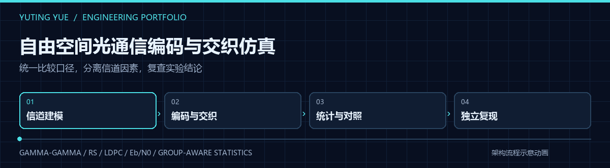
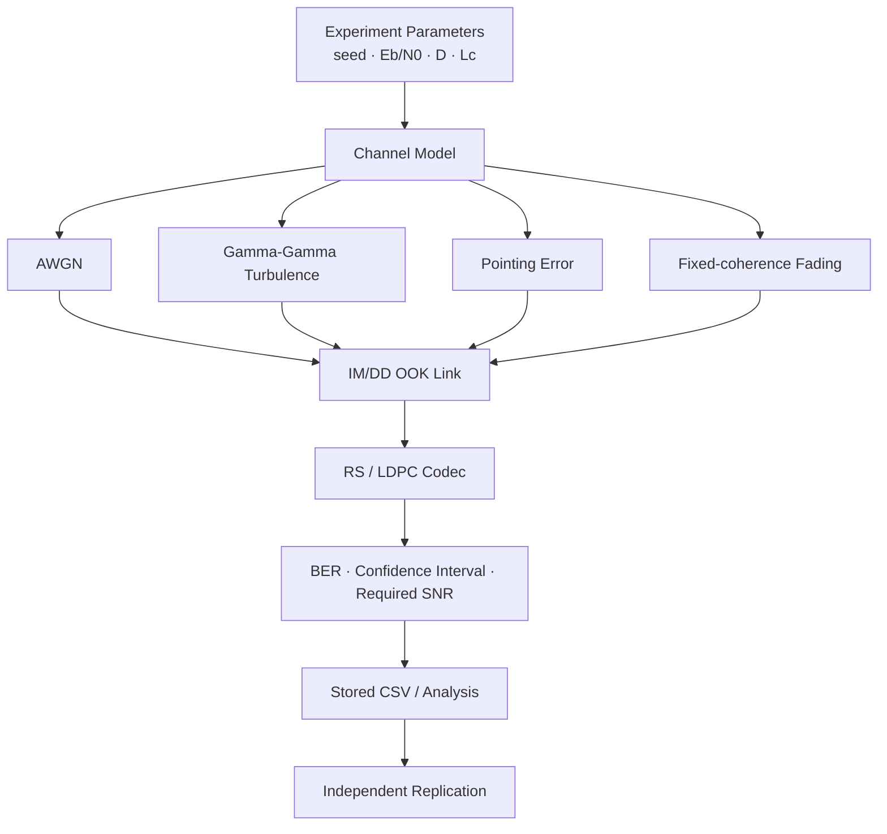

# 自由空间光通信编码与交织仿真



<sub>架构流程示意动画 · [静态版本](docs/assets/overview.png) · 动画不作为实测结果。</sub>

[返回技术作品集](https://github.com/KristenYue/KristenYue) · [机器人业务](https://github.com/KristenYue/telecom-network-incident-agent/blob/main/docs/ROBOT_DELIVERY.md) · [原生模型 SDK](https://github.com/KristenYue/edge-device-verification-lab/tree/main/inference_sdk) · [车辆 Agent](https://github.com/KristenYue/telecom-network-incident-agent/blob/main/docs/VEHICLE_ADAPTER.md)


**Python · NumPy · Gamma–Gamma · RS / LDPC · Monte Carlo · 统计区间**

对自由空间光通信链路建模，研究 **编码方案、交织深度和物理相干长度**的取舍。它为作品集提供通信专业基础与数值实验方法，设备 / AI 软件应用请先阅读 [主项目](https://github.com/KristenYue/telecom-network-incident-agent)。

## 核心方法与实验交付

| 实验难点 | 设计 | 能判断什么 |
|---|---|---|
| 两种编码公平对照 | RS(255,223) / LDPC(512,449)，码率约 **0.8745 / 0.8770**，统一信息比特 Eb/N0 | 相近冗余下的误码与复杂度差异 |
| 分离交织与信道变化 | 交织深度 D 与相干长度 Lc 独立；固定 Lc 扫描 D | 交织收益与缓存开销，避免改变物理信道偷换对照 |
| 相关样本统计 | 固定种子、分组感知区间、零误码上界 | 结论的不确定性及有限样本边界 |
| 结论可复查 | **14 个主实验脚本 / 12 个独立复现模块 / 7 个工程 Bad Case** | 从组件检查逐步复现最终对照 |

[实验地图](docs/EXPERIMENT_MAP.md) · [主实验](primary_experiments) · [独立复现](replication) · [工程日志](docs/ENGINEERING_LOG.md)

公开仓库交付代码与方法；CSV、NPZ、图表由脚本生成。本页不填入尚无公开结果文件支持的编码增益数字。


---

## 实验地图与模块

| 阶段 | 入口 | 作用 |
|---:|---|---|
| 01 | `01_channel_model_validation.py` | 验证 AWGN、Gamma–Gamma 和指向误差 |
| 02 | `02_uncoded_fso_ber.py` | 建立未编码链路基线 |
| 03 | `03_rs_awgn_validation.py` | 在引入衰落前验证 RS 行为 |
| 04 | `04c_*` / `04d_*` | 在两种固定相干长度下扫描 RS 交织 |
| 05 | `05_rs_coherence_depth_analysis.py` | 分析 BER、所需 SNR 与深度取舍 |
| 06 | `06_ldpc_awgn_validation.py` | 构造并验证码率匹配 LDPC |
| 07 | `07b_ldpc_fso_group_aware_refinement.py` | 在匹配信道上运行 LDPC |
| 08 | `08_rs_ldpc_final_comparison.py` | 比较 RS/LDPC 工作点 |
| 09 | `09_uncoded_fixed_coherence_coding_gain.py` | 计算匹配信道编码增益 |
| 10 | `10_turbulence_sensitivity.py` | 比较不同湍流条件 |

## 系统架构



## 模块实现

| 模块 | 实现 |
|---|---|
| Channel | AWGN reference、Gamma–Gamma sampling/moments、pointing error、fixed-coherence fading |
| Coding | RS(255,223) bounded-error checks；LDPC(512,449) parity 与无噪声往返检查 |
| Interleaving | 位/符号交织，`D` 与 `Lc` 独立控制 |
| Statistics | Wilson 区间、零错误上界、分组区间、common random numbers |
| Reproducibility | 固定主种子、条件子流、可恢复扫描、结果与分析分离 |
| Replication | 与主实验库路径分离的 NumPy codec/channel 实现 |


## 运行方法

```bash
python -m venv .venv
# Windows: .venv\Scripts\activate
# Linux/macOS: source .venv/bin/activate
python -m pip install -r requirements.txt
```

先运行组件验证，再决定是否启动计算量较大的扫描：

```bash
cd primary_experiments
python 01_channel_model_validation.py
python 03_rs_awgn_validation.py
```

独立复现路径：

```bash
cd replication
python fso_lib.py
python calc_baseline.py Moderate
```

## 源码与证据

| 内容 | 入口 |
|---|---|
| 主实验链 | [primary_experiments](primary_experiments) |
| 独立复现 | [replication](replication) |
| 实验地图 | [EXPERIMENT_MAP.md](docs/EXPERIMENT_MAP.md) |
| 工程决策 | [ENGINEERING_LOG.md](docs/ENGINEERING_LOG.md) |
| 失败案例 | [BAD_CASES.md](docs/BAD_CASES.md) |
| 公开来源与隐私检查 | [tools](tools) |

## 实验口径与适用范围

- 这是代码公开版；生成的 CSV、图片、论文和演示文档不在仓库中。
- 正式 Monte Carlo 扫描计算量较大，Quick Start 只运行组件验证。
- 统计区间和固定种子提高可复现性，但不能替代真实光学链路实验。
- 信道模型包含明确假设，不覆盖所有天气、平台抖动、硬件非线性和接收机实现。
- 独立复现降低单一实现依赖，但仍属于软件仿真，不是第三方实验室验证。

## 许可

[MIT](LICENSE)
