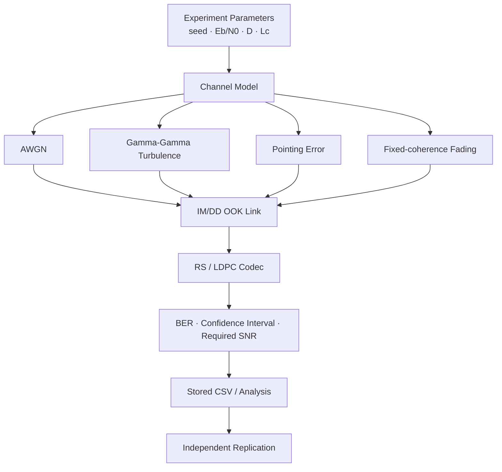

# Communication Systems Research — 无线光通信系统建模与编码研究

[](https://github.com/KristenYue/fso-coding-interleaving-simulator/actions/workflows/ci.yml)

## Project Overview

用于研究 IM/DD OOK 自由空间光通信链路中信道编码、交织深度和信道相干长度关系的 Python 仿真系统。模型组合 AWGN、Gamma–Gamma 大气湍流、零视轴指向误差和固定相干块衰落，并比较码率匹配的 Reed–Solomon 与 LDPC 方案。

项目体现通信工程背景和可复现实验能力，为工业 AI 应用中的链路认知、无线数据质量和通信系统建模提供领域基础；它不是 Agent 或设备控制项目。

## Application Scenarios

| 研究问题 | 仿真能力 |
|---|---|
| 湍流与指向误差如何改变 BER | 独立信道组件验证与组合链路 |
| 交织深度如何匹配相干长度 | 独立控制 `D` 与 `Lc` 的固定相干衰落实验 |
| 不同码率如何公平比较 | 基于信息比特 `Eb/N0` 的归一化 |
| RS 与 LDPC 的可靠性/复杂度取舍 | 码率匹配编码、目标 BER 与所需 SNR 比较 |
| 共享衰落样本如何估计不确定性 | 分组感知置信区间与零错误上界 |

## Features & Real Demonstration

### 完整实验链


| 阶段 | 入口 | 作用 |
|---:|---|---|
| 01 | `01_channel_model_validation.py` | 验证 AWGN、Gamma–Gamma 和指向误差 |
| 02 | `02_uncoded_fso_ber.py` | 建立未编码链路基线 |
| 03 | `03_rs_awgn_validation.py` | 在引入衰落前验证 RS 行为 |
| 04 | `04c_*` / `04d_*` | 在两种固定相干长度下扫描 RS 交织 |
| 05 | `05_rs_coherence_depth_analysis.py` | 分析 BER、所需 SNR 与深度取舍 |
| 06 | `06_ldpc_awgn_validation.py` | 构造并验证码率匹配 LDPC |
| 07 | `07b_ldpc_fso_group_aware_refinement.py` | 在匹配信道上运行 LDPC |
| 08 | `08_rs_ldpc_final_comparison.py` | 比较 RS/LDPC 工作点 |
| 09 | `09_uncoded_fixed_coherence_coding_gain.py` | 计算匹配信道编码增益 |
| 10 | `10_turbulence_sensitivity.py` | 比较不同湍流条件 |

## System Architecture



## Core Implementation

| 模块 | 实现 |
|---|---|
| Channel | AWGN reference、Gamma–Gamma sampling/moments、pointing error、fixed-coherence fading |
| Coding | RS(255,223) bounded-error checks；LDPC(512,449) parity 与无噪声往返检查 |
| Interleaving | 位/符号交织，`D` 与 `Lc` 独立控制 |
| Statistics | Wilson 区间、零错误上界、分组区间、common random numbers |
| Reproducibility | 固定主种子、条件子流、可恢复扫描、结果与分析分离 |
| Replication | 与主实验库路径分离的 NumPy codec/channel 实现 |

## Engineering Results

- 将编码前后的能量归一到信息比特 `Eb/N0`，避免不同码率的不公平比较。
- 将交织深度与物理相干长度分离，避免把独立快衰落误当作固定相干信道。
- 当多个帧共享同一衰落实现时，使用 group-aware 区间处理样本相关性。
- 长时间扫描按完成条件追加结果并支持重启跳过，避免中断后从头计算。
- 主实验与独立复现路径结构分离，用于检查结论是否依赖单一库实现。

## Industry Applications

- **半导体与 AI 芯片：** 通信算法原型、链路仿真、编码与统计分析工具。
- **智能汽车：** 无线/光通信链路建模方法、信道质量与数据可靠性分析。
- **具身智能：** 机器人无线链路与传感数据通信研究中的建模基础。

这些是研究方法的迁移方向；仓库没有实现车载通信、机器人通信或真实 FSO 硬件部署。

## Quick Start

```bash
python -m venv .venv
# Windows: .venv\Scripts\activate
# Linux/macOS: source .venv/bin/activate
python -m pip install -r requirements.txt
```

先运行组件验证，再决定是否启动计算量较大的扫描：

```bash
cd primary_experiments
python 01_channel_model_validation.py
python 03_rs_awgn_validation.py
```

独立复现路径：

```bash
cd replication
python fso_lib.py
python calc_baseline.py Moderate
```

## Evidence & Source Code

| 内容 | 入口 |
|---|---|
| 主实验链 | [primary_experiments](primary_experiments) |
| 独立复现 | [replication](replication) |
| 实验地图 | [EXPERIMENT_MAP.md](docs/EXPERIMENT_MAP.md) |
| 工程决策 | [ENGINEERING_LOG.md](docs/ENGINEERING_LOG.md) |
| 失败案例 | [BAD_CASES.md](docs/BAD_CASES.md) |
| 公开来源与隐私检查 | [tools](tools) |

## Validation & Limitations

- 这是代码公开版；生成的 CSV、图片、论文和演示文档不在仓库中。
- 正式 Monte Carlo 扫描计算量较大，Quick Start 只运行组件验证。
- 统计区间和固定种子提高可复现性，但不能替代真实光学链路实验。
- 信道模型包含明确假设，不覆盖所有天气、平台抖动、硬件非线性和接收机实现。
- 独立复现降低单一实现依赖，但仍属于软件仿真，不是第三方实验室验证。

## License

[MIT](LICENSE)
